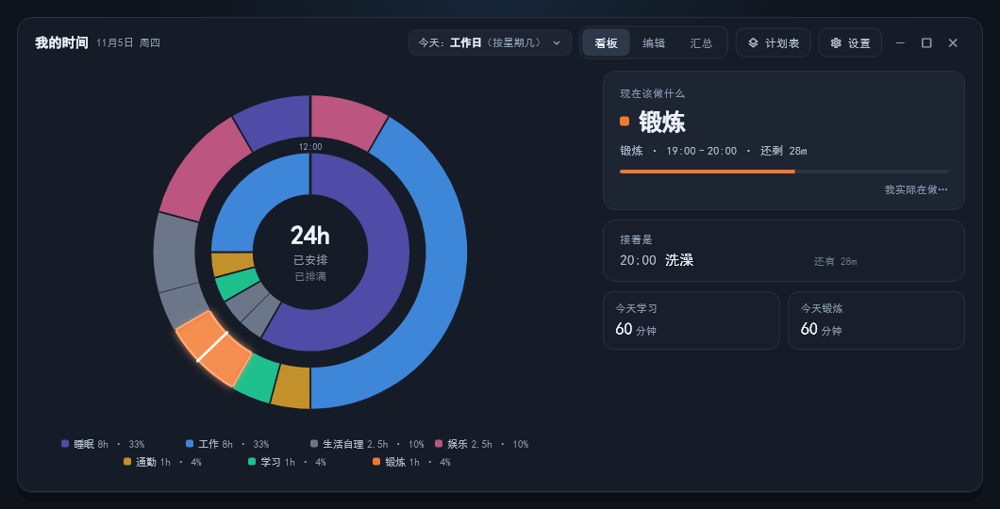
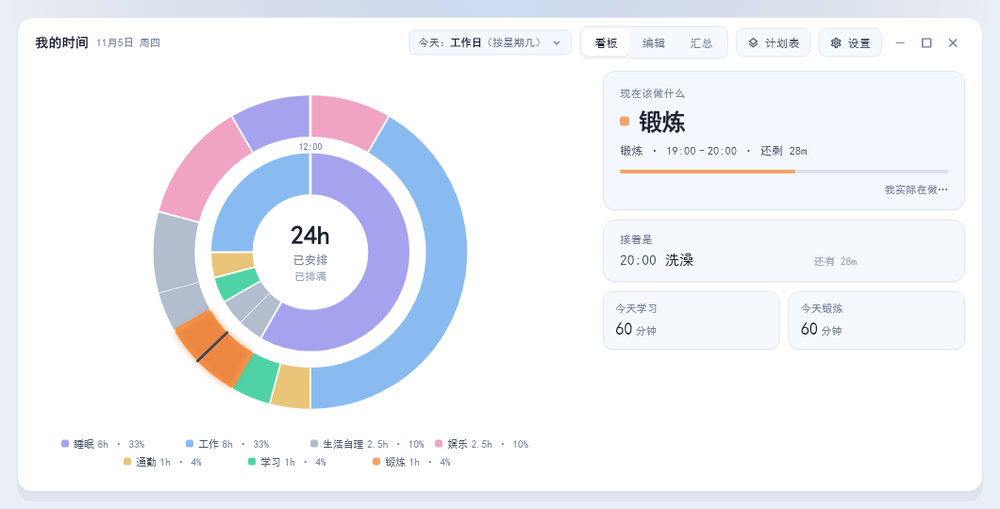
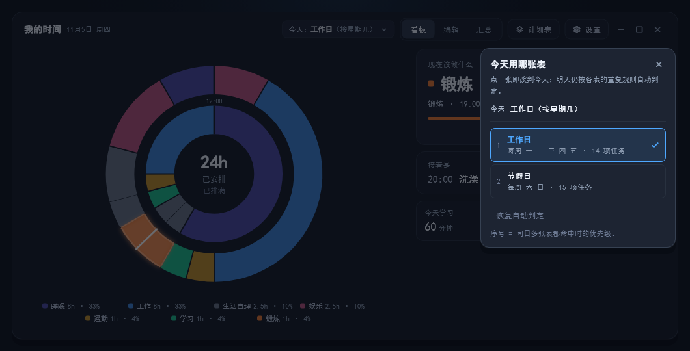
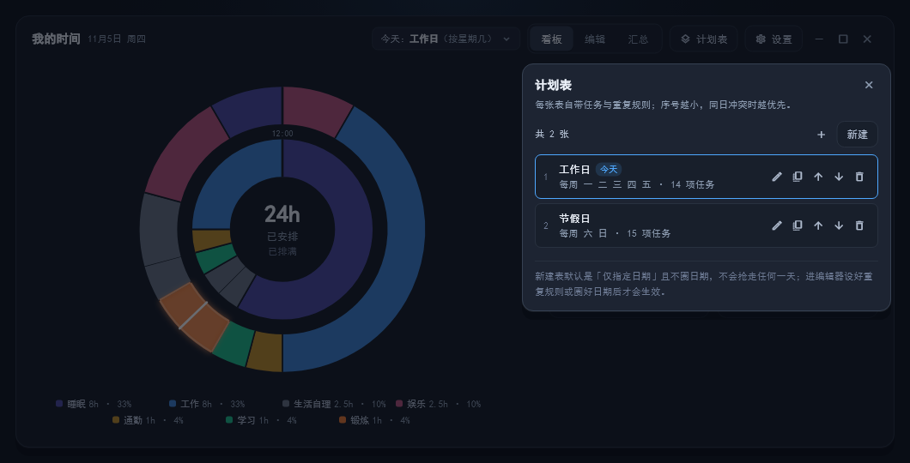
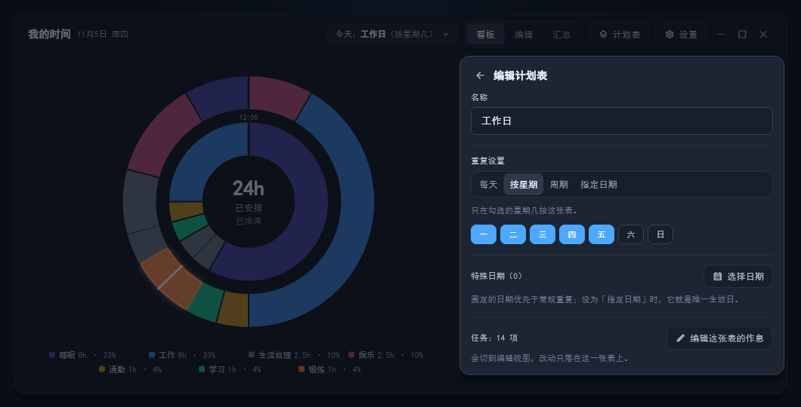
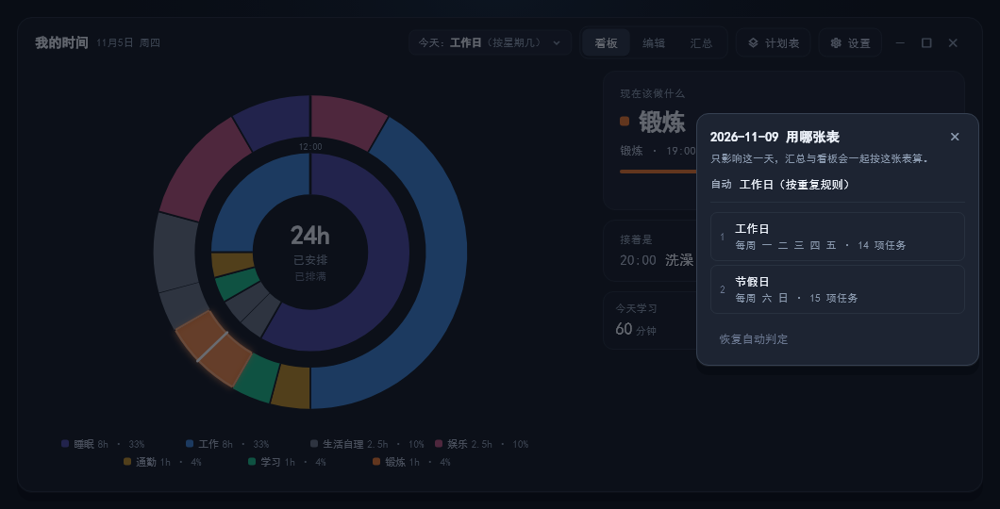
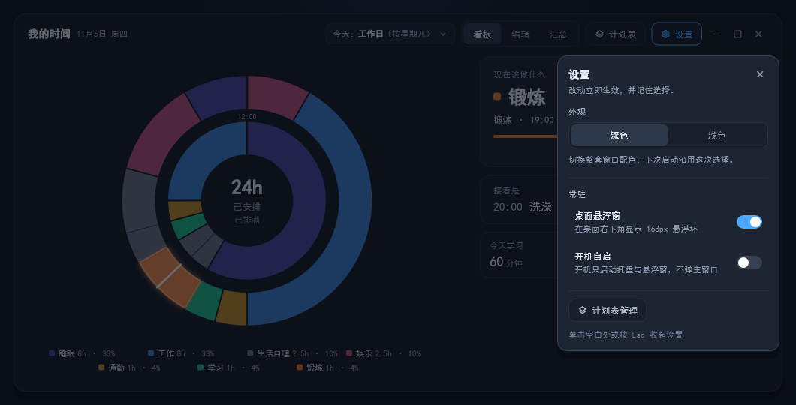
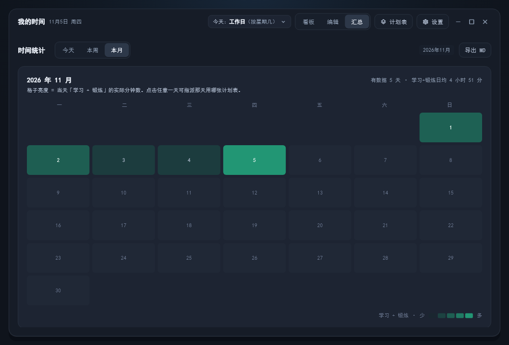
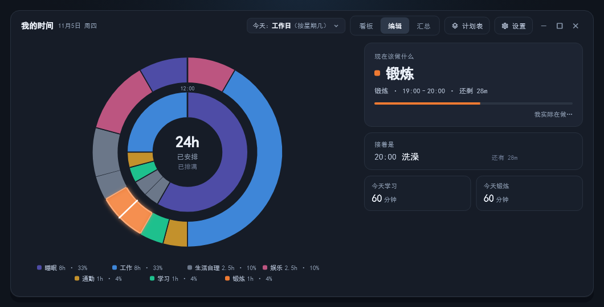
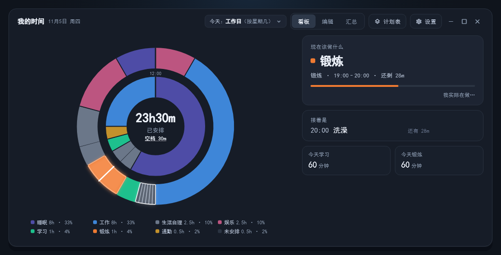

# 我的时间 · 作息提醒器

> 常驻托盘的 Windows 桌面应用：把计划摊进一天的 24 小时，随时告诉你**现在该做什么、接下来做什么**。
> 少花时间纠结「下一步该干什么」，把注意力留在手上这件事，而不是被短视频带走。



[](LICENSE)
[]()
[]()

当前版本 **v0.9.2+1**。界面为简体中文，支持**浅色 / 深色双主题**。

---

## 这是什么

一个把**计划**翻译成「此刻该做什么」的本地小工具。做它的初衷很具体：

> 把计划可视化到具体时间，到点就照着做；不必反复想「接下来该干什么」，
> 也不在空档里靠刷短视频把时间耗掉。

- **先把计划摆上时间轴**：外环是 24 小时，睡眠、工作、学习、锻炼、娱乐、通勤、生活自理……按天排成一圈，颜色对应分类。没安排的时间会留出斜纹空档 —— 空档往往就是最容易滑去刷手机的地方。
- **再省掉临场决策**：圆心实时给出「现在该做什么 / 还剩多久 / 下一项」，配合托盘与 168px 悬浮环常驻。要走神的时候，下一个具体动作已经在眼前，不用重新想一遍，也不用靠意志力硬扛。
- **换日子不该重新想一遍**：工作日、休息日、特殊日期各是一张计划表，当天只用一张；中途临时改判，看板 / 编辑 / 汇总不会各算一套。
- **不打分、不排名、不做事后审判**：统计只是用来回看安排合不合理，不是给你评成绩。它的主战场在「现在」，不在「事后」。

它更像一张一直贴在眼前的时刻表，而不是待办清单或复盘报表。
数据只存在本机的一个 JSON 文件里，不联网、不上传、不需要账号。

---

## 一眼看懂

| 深色主题 | 浅色主题 |
| :---: | :---: |
|  |  |

**多计划表**：像闹钟一样，可以为不同日子准备不同的表，每张表自带任务与重复规则。

| 切换今天用哪张表 | 管理所有计划表 |
| :---: | :---: |
|  |  |

| 单张表的重复设置 | 在日历上给某天单独指派 |
| :---: | :---: |
|  |  |

**设置与汇总**：

| 设置面板 | 本月汇总热力图 |
| :---: | :---: |
|  |  |

<details>
<summary>更多界面（编辑任务、空档高亮）</summary>

**编辑视图**：时间轴 + 任务清单，拖拽边界即可调整作息块。



**空档定位**：把鼠标停在圆心的「空档 xx」上，圆环上对应的未安排时段会被高亮出来。



</details>

> 以上截图全部由 Flutter 引擎在测试中真实渲染（`test/goldens/`），不是设计稿或示意图。

---

## 主要功能

所有功能都指向同一件事：**在具体时间，把具体工作推到眼前**。
圆环负责把计划可视化，倒计时与「下一项」负责把注意力拉回当下，汇总只用来回看安排得合不合理。

| 模块 | 能做什么 |
| --- | --- |
| **L1 看板** | 双环 24 小时、当前块倒计时、下一项、今日分类时长、空档高亮 |
| **L2 编辑** | 时间轴拖拽调整、任务清单增删改、分类选择、跨零点作息 |
| **L3 汇总** | 今天 / 本周 / 本月三档统计、月历热力图、导出 Markdown |
| **多计划表** | 新建 / 复制 / 重命名 / 删除 / 排序；表内任务与重复规则独立 |
| **重复规则** | 每天、按星期、按周期（含大小周锚点）、仅指定日期；特殊日期优先于常规重复 |
| **单日改判** | 顶栏一键切换今天用哪张表；月历点某天可单独指派，压过所有自动规则 |
| **桌面常驻** | 系统托盘、168px 桌面悬浮环、开机自启（不弹主窗口）、浅/深主题记忆 |
| **数据** | 本地 JSON 原子写入；v1 → v2 自动迁移并留 `.bak` |

**同一天只用一张表**：所有界面（看板 / 编辑 / 汇总 / 悬浮窗）都走同一个日期判定入口，
所以「过了大半天才临时切换」不会让看板和汇总各算一套。

---

## 运行

### 方式一：直接运行预编译版

到本仓库的 [Releases](https://github.com/JieJingKe/routine-reminder/releases) 下载 Windows 压缩包，解压后双击 `routine_reminder.exe`。

> **请整目录解压**：exe 同目录的插件 `.dll`、`flutter_windows.dll` 和 `data/` 文件夹都是运行必需的，单独拷一个 exe 起不来。
> 关闭主窗口不会退出程序，需要从托盘图标的菜单里选「退出」。

### 方式二：从源码构建

前置条件：

- Flutter SDK **3.13+**（`flutter doctor` 中 Windows 一项可用）
- Visual Studio 2022 的「**使用 C++ 的桌面开发**」工作负载
- Windows 10/11

```bash
flutter pub get
flutter run -d windows          # 调试运行
flutter build windows --release --no-tree-shake-icons
```

产物在 `build\windows\x64\runner\Release\`，同样是整目录分发。

> `--no-tree-shake-icons` 是必须的：增量构建会复用被裁剪过的图标字体，
> 设置齿轮等图标会显示为空白。完整 `MaterialIcons-Regular.otf` 约 1.6 MB。

若机器上开着系统代理，`flutter_tester` 连本地 WebSocket 会被劫持，
跑测试前先清掉：

```bash
unset http_proxy https_proxy all_proxy HTTP_PROXY HTTPS_PROXY ALL_PROXY
export NO_PROXY=localhost,127.0.0.1
```

---

## 数据存在哪

```
%APPDATA%\com.jason\routine_reminder\data.json
```

首次启动写入内置的两张示例表。写盘是「先写 `.tmp` 再改名」的原子操作，
避免断电留下半截 JSON。结构版本为 **v2**；读到旧版 v1 会自动迁移，
迁移前先备份成 `data.json.bak`。

汇总里的「实际」一列目前仍是**计划值 + 空覆盖**，尚未做真实行为采集，
所以请不要把它当成已完成的事实记录。这不动摇主用途：它首先是执行导航，
统计只是辅助回看。

---

## 代码结构

```
lib/
├── domain/     纯 Dart，不 import Flutter：分类、作息块、时间计算、
│               重复规则 / 计划表、统计、编辑逻辑（可单独 dart run）
├── data/       AppData 根对象、示例数据、汇总口径与 Markdown 导出、
│               AppRepository 唯一读写入口（含 v1→v2 迁移）
├── design/     tokens.dart：颜色 / 字号 / 圆角 / 间距唯一来源，浅深主题切换
├── ui/
│   ├── ring/   双环几何与 CustomPainter
│   ├── l1/     看板
│   ├── l2/     编辑：时间轴 + 任务清单
│   ├── l3/     汇总：今天 / 本周 / 本月
│   ├── shell/  顶栏、设置、计划表选择 / 管理 / 编辑器、浮层
│   └── widgets/ 卡片、分段控件、日历格、hover 判定等
├── float/      悬浮窗独立进程（--float），只接收主进程推送的状态
├── app/        窗口、托盘、开机自启、主题、视图切换、时间轮询
└── main.dart   入口与窗口初始尺寸

test/           单元测试 + 19 张 golden 基线截图
tool/           领域逻辑探针、v1→v2 迁移演练
windows/        Flutter Windows runner（CMake 外壳）
```

设计上的两条硬规矩：

1. `lib/domain` 保持**纯 Dart**——只要有一个文件引入 `package:flutter`，
   所有 `dart run tool/*.dart` 都会因 `dart:ui` 不可用而崩。
2. 所有浮层（设置 / 表选择 / 管理 / 日历指派）**内嵌主窗口的 `Stack`**，
   不用 `showDialog`：顶层路由不随静态主题门面重建，切主题会出现浮层不换色。

---

## 开发自检

```bash
dart format lib test
dart analyze lib test                  # 期望 No issues found
dart run tool/check_domain.dart        # 领域逻辑探针，看得见每一步的值
flutter test                           # 171 个用例 + 19 张 golden 比对
flutter test --update-goldens          # 改了配色 / 布局后重拍基线
```

`test/golden_harness.dart` 复刻了真实圆角窗口外壳；L1 用 `1060×540`，
L2 / L3 用 `1060×720`。**L2 第一屏高度写死为 `Spacing.dashboardBodyHeight`，
不要改成 `constraints.maxHeight`**，否则环会被垂直居中、图例推到底，第一屏不再等于 L1。

---

## 已知限制 /  roadmap

- **仅 Windows**。没有 macOS / Linux / 移动端版本，也没有云同步。
- 「实际」行为尚未采集；半天分段（上午 A 表、下午 B 表）未实现，当前一天只认一张表。
- 计划表按序号优先级匹配，同一天多张表都命中时取第一张，不做合并。
- 悬浮窗是独立进程，通过本机连接接收状态；只允许一个主实例。

欢迎提 Issue 或 PR，尤其是跨平台适配、数据导入导出和统计口径方面的想法。

---

## 技术取舍

- `window_manager` / `tray_manager` 停在 **0.5.x**：0.6.0 起改走 nativeapi，
  编译前要现场跑 `vcvars64.bat` 编 C++，等于凭空多一个「必须装 MSVC + SDK」的前置条件。
  0.5.x 是纯 Dart FFI 调 user32/shell32，API 一致，`flutter test` 也能直接跑。
- 主窗口**不透明**（底色铺满），只有悬浮窗透明：透明主窗口在最大化 / 还原动画时
  会被 DWM 整块重合成一次，肉眼就是一闪。
- 环上色块默认全是满色，只有编辑态明确指向某块时才把其余块压暗——
  整体压到 0.75 会让整套配色发灰。
- 可点控件统一「**停留 110ms 才算 hover**」，命中区域严格等于按钮边界，
  避免鼠标横扫顶栏时留下一串深色残影。

---

## 许可证

[MIT](LICENSE) © 2026 routine-reminder contributors

你可以自由使用、修改、分发，包括商业用途；保留版权声明即可。
软件按「原样」提供，不作任何担保。
